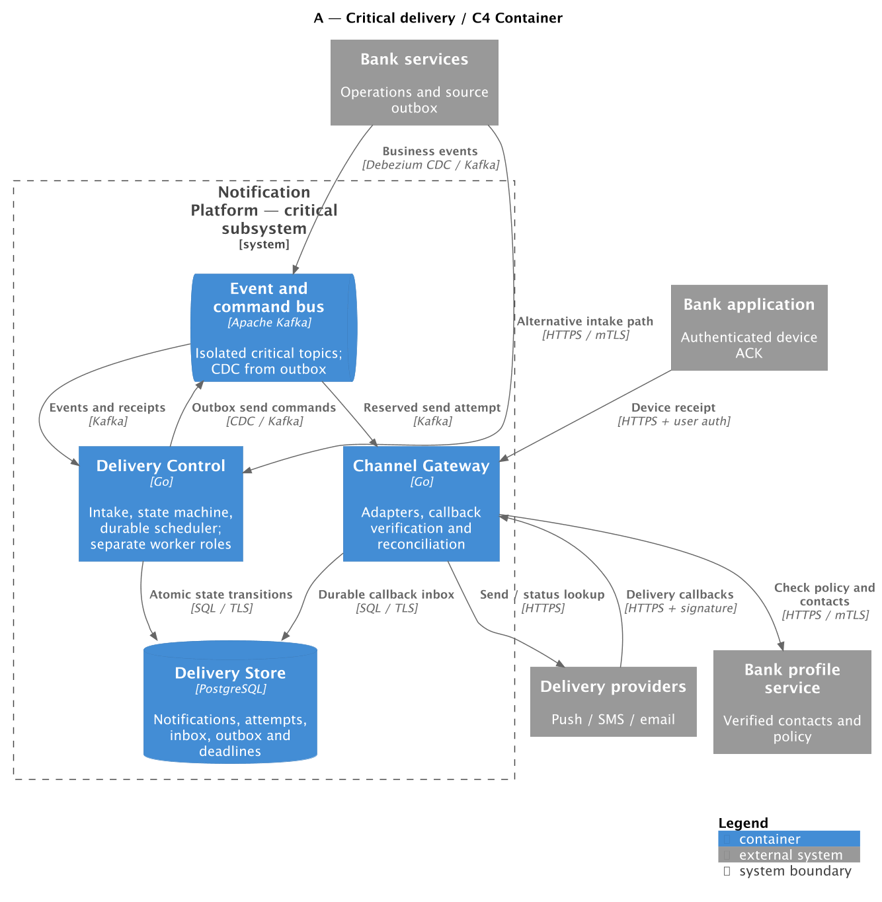
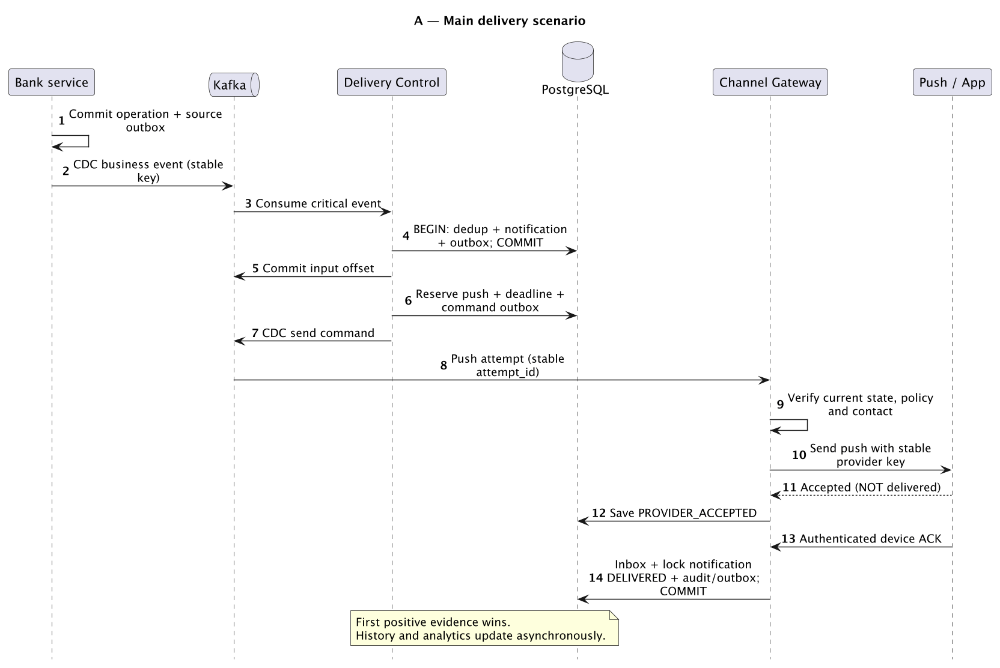
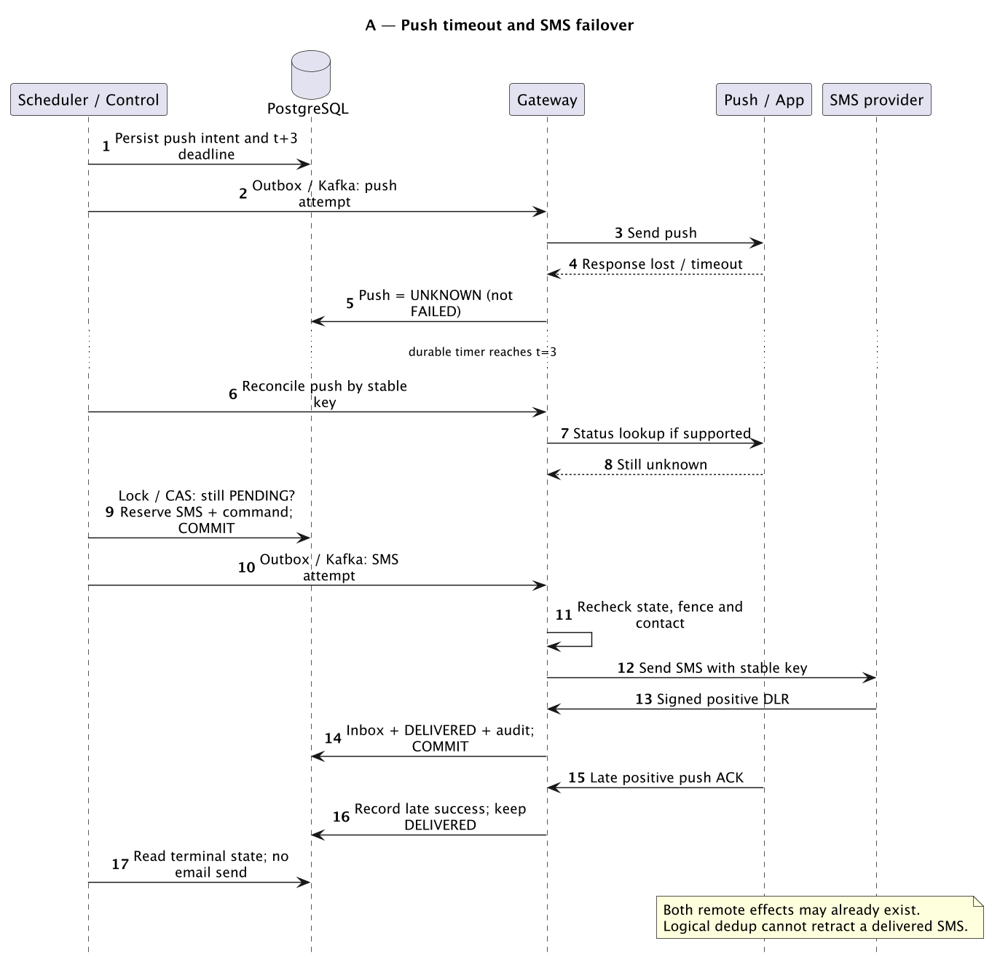
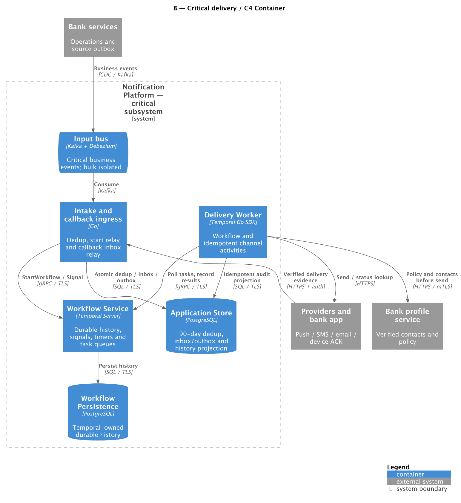
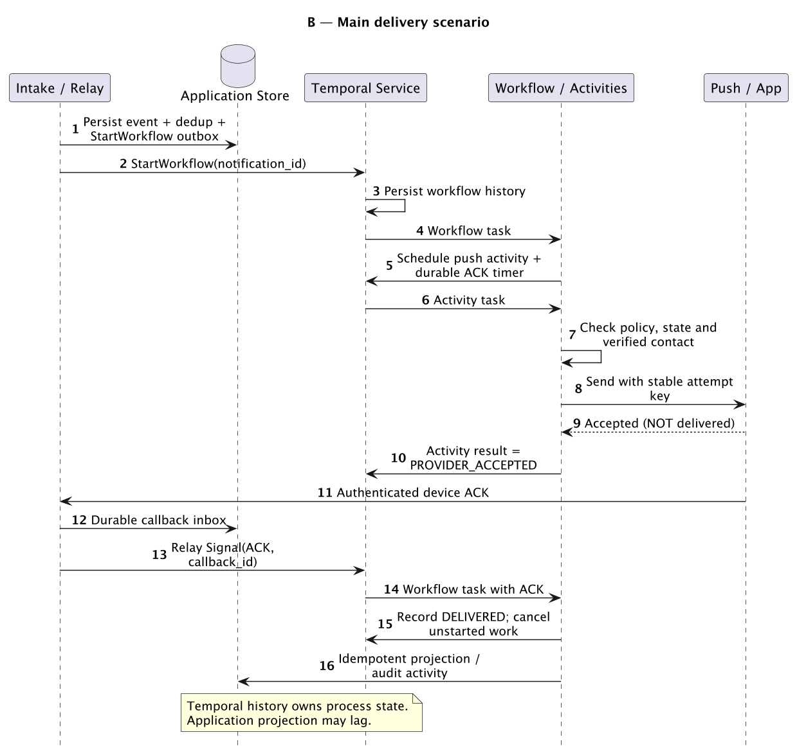
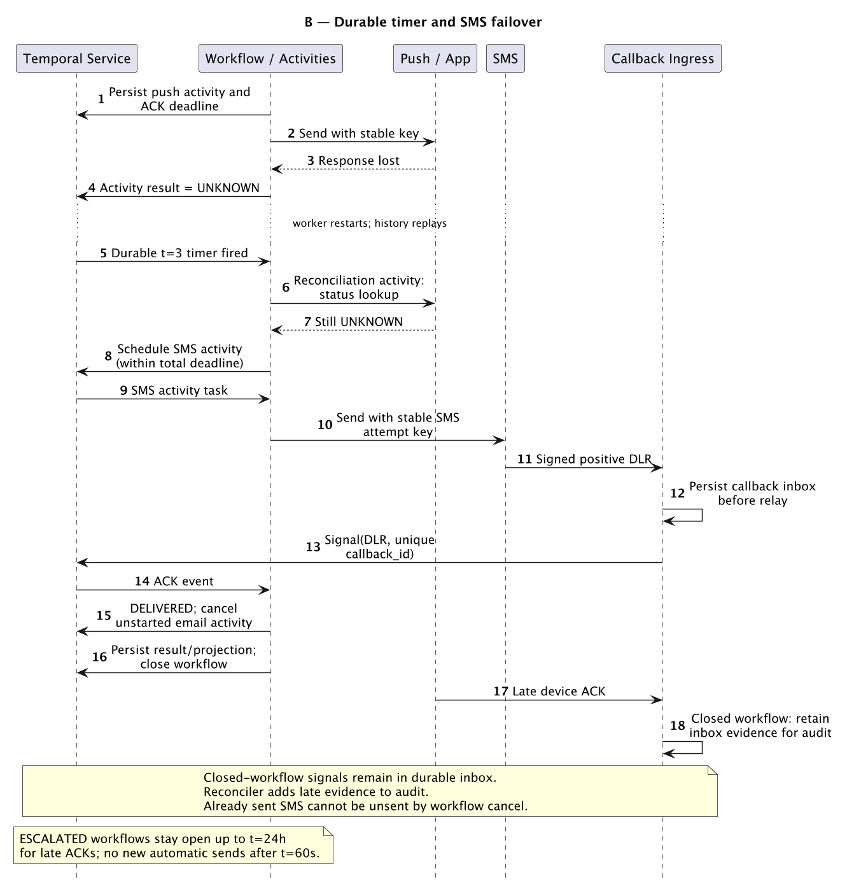

Сейчас команды банка отправляют уведомления независимо друг от друга. Я предлагаю объединить отправку в одной платформе, отделив критичные сообщения от массовых рассылок. Для транзакционного контура выбран вариант Kafka и PostgreSQL с последовательным переключением push → SMS → email. Ниже сформулированы требования к платформе и приведён RFC с обоснованием этого решения и сравнением с Temporal.

Все целевые показатели, коэффициенты пиков, тарифы и политика каналов ниже — проектные допущения автора, если они не заданы условием. Эти числа требуют согласования с бизнесом и проверки на стенде; они не являются результатами проведённого нагрузочного тестирования.

# 1 Функциональные требования

**FR-01. Единая отправка.** Команды банка передают уведомления через общую платформу с указанием пользователя, события и типа сообщения. Пользователь получает согласованный текст независимо от команды отправителя. Связь с целью: меньше противоречивых сообщений и жалоб.

**FR-02. Приоритет критичных сообщений.** Подтверждения переводов и списаний обслуживаются раньше рекламных рассылок. Массовая кампания не должна задерживать сообщение о движении денег. Связь: доверие и retention.

**FR-03. Резервная доставка.** Если основной канал не подтвердил доставку критичного сообщения в установленный срок, система автоматически использует доступный резервный канал. Результат остаётся доступен поддержке. Связь: доставка критичных сообщений.

**FR-04. Настройки пользователя.** Пользователь выбирает предпочтительный доступный канал. Маркетинг требует явного согласия и может быть полностью отключён; информационные сервисные напоминания также отключаются. Подтверждения движения денег и безопасности не отключаются внутри банка: это продуктовая политика, требующая отдельного согласования. Платформа не может отменить запрет push на уровне ОС или создать отсутствующий номер/email. Если разрешённых и проверенных контактов нет, система сообщает о недоставке ответственным сотрудникам.

**FR-05. Защита от повторов.** Повторная передача одного бизнес-события не создаёт второе логическое уведомление тому же пользователю. При переключении каналов система прекращает дальнейшие отправки после подтверждения и по возможности отменяет ещё не отправленные попытки. Полностью исключить два уже отправленных внешних сообщения при неопределённом исходе невозможно; граница описана в RFC.

**FR-06. Массовые кампании.** Сотрудник может запустить кампанию на аудиторию до 1 млн пользователей, приостановить её и увидеть отправленные, доставленные, отклонённые и ожидающие сообщения. Согласия проверяются непосредственно перед отправкой. Связь: управляемая коммуникация и retention.

**FR-07. Ограничение частоты.** Маркетинг отправляется по местному времени с 09:00 до 21:00, не более 5 сообщений пользователю за календарные сутки по всем кампаниям вместе. Часовой пояс берётся из профиля, при его отсутствии — из явно выбранного пользователем банковского региона. Критичные сообщения не задерживаются тихими часами. Связь: снижение жалоб.

**FR-08. История и поддержка.** Пользователь видит уведомление один раз в истории приложения, сотрудник поддержки — канал, время, статус и причину недоставки без раскрытия лишних персональных данных. История сама по себе не подтверждает внешнюю доставку.

**FR-09. Недоставка не скрывается.** После исчерпания каналов или общего срока ожидания критичное сообщение попадает на разбор; позднее подтверждение отражается в истории. Отсутствие ответа не отображается как успех. Связь: контроль критичных событий и снижение жалоб.

**FR-10. Измерение результата.** Платформа предоставляет данные для оценки удержания и жалоб с привязкой к кампании и типу сообщения, а также позволяет сравнить группы пользователей. Связь: проверяемость бизнес-целей.

# 2 Нефункциональные требования

Замер задержек начинается с устойчивого принятия сообщения платформой, `accepted_at`, если не указано иначе. Доставка определяется подтверждениями каналов из раздела «Семантика гарантии». Отдельно измеряется время от фиксации банковской операции, чтобы задержки до платформы не оставались невидимыми.

| ID | Требование и способ измерения |
|---|---|
| NFR-01 | В здоровом push-канале p95 времени до ACK приложения ≤2 с. Для всех принятых критичных уведомлений ≥99,9% подтверждены за 30 с и ≥99,99% за 60 с за скользящие 30 суток. Считать по уникальным уведомлениям, не по попыткам. Отсутствующие контакты и внешние отказы остаются в знаменателе и расходуют бюджет ошибок. |
| NFR-02 | API приёма доступен ≥99,99% за 30 суток; p99 устойчивого приёма ≤200 мс при проектной нагрузке. Успех возвращается только после устойчивой записи; при невозможности записи — ошибка, не ложный успех. |
| NFR-03 | Поддерживаются 10 000 логических уведомлений/с на входе, в том числе зарезервированные 1 400 критичных/с. Кампания 1 млн обработана ≤15 мин при доступных каналах и квотах. Проверка — 30-минутный нагрузочный сценарий с кампанией и остановкой одного воркера. |
| NFR-04 | Для принятых событий RPO=0 при отказе одного узла или одной зоны доступности. После такого отказа критичная обработка возобновляется ≤60 с. Проверка — fault injection между фиксацией состояния, публикацией и подтверждением. Региональная катастрофа рассматривается отдельно. |
| NFR-05 | Повторы с тем же бизнес-ключом в течение 90 дней дают один `notification_id`. Одновременно планируется не более одной новой попытки для уведомления. Дубли внутри приложения ≤0,01%; внешние подтверждённые дубли ≤0,1% критичных за 30 суток. Проверка — конкурентные повторы, callback reorder и потерянный ответ провайдера. |
| NFR-06 | Подтверждённое отключение маркетинга применяется к новой отправке ≤5 с, включая уже подготовленную кампанию; в тесте с 10 000 конкурентных изменений согласия — ноль отправок после этого окна. Уже переданное провайдеру сообщение не всегда отзывается. |
| NFR-07 | 100% внешних соединений защищены TLS ≥1.2; для внутренних сервисов mTLS, права по роли и назначению. Callback без проверенной подписи/защиты от replay не меняет статус. В push, SMS и операционных логах нет полного номера карты, баланса, OTP и полных реквизитов перевода. |
| NFR-08 | У каждой попытки есть `notification_id`, `attempt_id`, причина и временные метки. Метрики задержки, недоставки и очередей обновляются ≤15 с; сигнал о росте недоставки критичных приходит дежурному ≤60 с после срабатывания порога. Содержимое сообщений и контакты не попадают в метки метрик. |
| NFR-09 | Для базового профиля критичных сообщений средняя расчётная стоимость ≤0,30 ₽ за логическое уведомление при учебных тарифах из раздела «Выводы». Бюджет контролируется ежедневно; превышение вызывает предупреждение, но не отключает критичную доставку. |
| NFR-10 | За 90 дней сохраняется ключ дедупликации и история критичных попыток; payload хранится отдельно не более 30 дней, затем удаляется. Восстановление резервной копии и проверка связности состояния — минимум ежеквартально. Конкретные сроки хранения согласовываются с банком, здесь это проектная политика. |

Цели NFR-01 не являются обещанием доставить человеку сообщение при любом состоянии мира. Они задают наблюдаемый SLO и могут быть нарушены, например, массовым отказом оператора. Платформа фиксирует нарушение и запускает восстановление. При 6 млн критичных в день месячный поток около 180 млн: бюджет 0,01% для 60-секундного SLO — 18 000 сообщений. Бюджет доступности API 0,01% за 30 дней — около 4,32 минуты.

**Проверка бизнес-целей.** Retention определяется как D30 для месячной когорты: доля пользователей, активных на 30-й день после включения в эксперимент. Цель +15% относительная: при baseline 40% целевое значение 46%, а не 55%. Жалобы — число обращений с темой уведомлений на 10 000 доставленных логических сообщений; цель −30%, например с 10 до 7. Baseline собирается 4 недели. Рандомизированный эксперимент проводится на необязательных сервисных/маркетинговых коммуникациях, критичные сообщения получают обе группы. Длительность ≥6 недель с дозреванием D30; размер выборки рассчитывается после baseline, критерий — 95% доверительный интервал эффекта. Удержание не гарантируется одной архитектурой: частота, содержание и продукт тоже влияют на результат.

# 3 Архитектурно значимые требования

Приоритеты: P0 — обязательные условия безопасности и корректности; P1 — целевые качества, подлежащие настройке после выполнения P0.

| ASR и приоритет | Связанные требования | Почему определяет архитектуру |
|---|---|---|
| ASR-01 Быстрая критичная доставка, P0 | FR-02, FR-03; NFR-01, NFR-03 | Общая очередь допускает блокировку рекламой. Требуются изолированные ресурсы, короткий путь и дедлайны ожидания. |
| ASR-02 Устойчивая обработка и failover, P0 | FR-03, FR-09; NFR-02, NFR-04 | Процесс должен пережить падение между записью и отправкой. Нужны устойчивое состояние, восстановление и подтверждения снаружи. |
| ASR-03 Дедупликация при неопределённом исходе, P0 | FR-05, FR-08; NFR-05 | Локальная транзакция не охватывает телефон и провайдера. Нужны идентификаторы, сериализация переходов и отдельное состояние UNKNOWN. |
| ASR-04 Управляемый массовый поток, P1 | FR-06, FR-07; NFR-03, NFR-09 | Кампания создаёт всплеск; квоты и стоимость каналов ограничивают полезный параллелизм. Нужны backpressure и независимое масштабирование. |
| ASR-05 Настройки и защита данных, P0 | FR-04, FR-07, FR-08; NFR-06, NFR-07, NFR-10 | Нельзя рассылать по устаревшему согласию и распространять контакты по очередям. Нужны авторитетная политика и защищённый адресный справочник. |
| ASR-06 Наблюдаемость и доказательство результата, P1 | FR-09, FR-10; NFR-08, NFR-09 | «Провайдер принял» и «доставлено» различаются. Нужны сквозная корреляция, аудит переходов и сверка зависших попыток. |

# 4 Ключевые архитектурные вопросы

1. **Где проходит граница успешной доставки?** Источники: ASR-02/06, FR-03/09. Если HTTP 200 считать доставкой, банк будет показывать ложный успех. Нужно заранее согласовать доказательство по каждому каналу и учесть отсутствие подтверждений.
2. **Как кампании не задержат списание средств?** Источники: ASR-01/04, NFR-01/03. Важны отдельные очереди, пулы, соединения с БД и квоты провайдеров: приоритет сообщения в общей очереди сам по себе недостаточен.
3. **Кто решает, что пора переключать канал после таймаута?** Источники: ASR-02/03, FR-05. Два независимых воркера могут запустить SMS и email одновременно. Один владелец состояния и атомарный переход должны разрешать только одну следующую попытку.
4. **Писать свою оркестрацию или использовать workflow engine?** Источники: ASR-02/03/06. Это выбор между уже освоенным стеком и готовыми долговечными таймерами ценой новой инфраструктуры, требований к replay и стоимости истории.
5. **Как обеспечить актуальность согласий в очереди на миллион адресатов?** Источники: ASR-05, FR-04/06. Снимок аудитории при старте не заменяет проверку перед отправкой; иначе отзыв согласия не работает.
6. **Каков разумный бюджет SMS при массовом отказе push?** Источники: ASR-01/04, NFR-09. Экономия и срок доставки конфликтуют. Для критичных сообщений приоритет имеет срок; маркетинг приостанавливается.

# 5 Архитектурные последствия ASR

**ASR-01.** Транзакционные события поступают в отдельные топики и отдельные пулы воркеров; резервируются CPU, соединения БД и исходящие квоты. Маркетинг тормозится раньше критичного потока. История приложения и аналитика обновляются асинхронно вне короткого пути.

**ASR-02.** Банковская операция и исходное событие связываются transactional outbox; подтверждение приёма платформой связано с записью в БД. Оркестратор хранит дедлайны и пытается восстановить UNKNOWN по callback или запросу статуса. Брокер и БД размещаются в трёх зонах, неисправность не должна уничтожать единственную копию.

**ASR-03.** Уведомление имеет бизнес-ключ, попытка — стабильный ключ провайдера; состояние меняется атомарно. Callback обрабатывается идемпотентно, поздний успех принимается, отрицательный ответ не отменяет уже зарегистрированный успех. При неизвестном исходе выбирается осознанный компромисс: допускается редкий внешний дубль ради срока доставки.

**ASR-04.** Адресаты кампании разворачиваются порциями; используются квоты, ограничение одновременных запросов и масштабирование по возрасту очереди. Разные классы имеют отдельные бюджеты и политику перегрузки. Рассылать 1 млн получателей одним синхронным запросом нельзя.

**ASR-05.** Тип критичности задаёт разрешённый для команды шаблон, а не произвольное поле запроса. Контакты берутся из защищённого справочника; в брокере передаются ссылки и минимальный контекст. Отзыв согласия инвалидирует кэш; при недоступности авторитетных настроек маркетинг не отправляется. Для критичных используется последняя проверенная политика без отключаемого рекламного согласия.

**ASR-06.** Аудит хранит изменение состояния и причину в одной транзакции, затем поступает в аналитику. Метрики различают принятие, отправку, подтверждение и прочтение; неопределённые попытки сверяются отдельно. Сигналы ориентированы на пользовательскую задержку, а не только на загрузку CPU.

# 6 Решения которые не подходят

1. **Синхронно вызвать SMS из обработчика перевода и ждать провайдера.** Нарушает ASR-01/02: задержка провайдера блокирует банковскую операцию, а падение после перевода до вызова создаёт потерю уведомления. Outbox устраняет разрыв, уведомления обслуживаются отдельно.
2. **Одна FIFO-очередь и один общий пул на все классы.** Нарушает ASR-01/04: миллион рекламных сообщений занимает очередь, сокеты и квоты перед транзакционными. Требуется изоляция, а не только поле `priority`.
3. **Сразу отправлять во все три канала или бесконечно повторять timeout.** Нарушает ASR-03/04: первый подход создаёт дубли и стоимость, второй может повторно отправить уже принятое сообщение и вызвать лавину запросов. Используются ограниченные попытки, reconciliation и последовательный failover.
4. **Считать Kafka exactly-once гарантией одного SMS.** Нарушает ASR-02/03/06: запись в Kafka не атомарна с внешним SMS. Для внешней системы требуется её участие в идемпотентности; это ограничение отмечает и [документация Kafka](https://kafka.apache.org/41/design/design/).

# 7 Неопределённости и архитектурные риски

| Неизвестное и риск | Как проверить и что изменится |
|---|---|
| Нет профиля реальных пиков и распределения по времени | Снять обезличенные счётчики за 4 недели; построить p99 по секундным интервалам и всплески на праздники. Уточнить число партиций и резерв ресурсов. |
| Неизвестны доля рабочих push-токенов, проверенных контактов и задержки DLR | Пилот на согласованной аудитории, измерить распределение ACK и долю недостижимых. Если недостижимых >0,01%, целевой 60-секундный SLO нельзя обещать без улучшения контактов. |
| Провайдеры могут не поддерживать idempotency key, поиск по ключу и отмену | Контрактные тесты в sandbox: потерять HTTP-ответ, повторить ключ, задержать callback, проверить replay и отмену. При отсутствии возможностей адаптер помечается как допускающий неопределённость, слепой повтор запрещён. |
| Два SMS-провайдера могут зависеть от одного оператора | Запросить схему зависимости и протестировать общий отказ. Резервировать разные маршруты; не перемножать вероятности отказов без доказательства независимости. |
| Неизвестно, поможет ли новая коммуникация удержанию | A/B-тест по методике раздела 2. При отсутствии эффекта менять содержание и частоту, не объявлять архитектуру доказательством роста retention. |
| Не проверены производительность PostgreSQL и навыки эксплуатации Temporal | Одинаковый стендовый сценарий для обоих вариантов: пик, падение узла, повтор callback и сравнение стоимости. Результаты могут изменить выбор RFC. |

# 8 RFC: Гарантированная доставка критичных уведомлений с переключением между каналами

| Метаданные | Значение |
|---|---|
| Статус | DESIGN |
| Автор | Гузаиров Тимур Булатович |
| Ответственный | Владелец платформы уведомлений — проектная роль |
| Бизнес-заказчик | Владелец цифровых каналов банка — проектная роль |
| Ревьюеры | Не назначены |
| Дата создания | 2026-11-17 |
| Дата обновления | 2026-11-17 |

Рекомендуется вариант A — Kafka и PostgreSQL. Он подходит для ограниченного процесса из трёх каналов и позволяет использовать стек, который, по принятому допущению, уже есть в банке. Temporal рассматривается как альтернатива для более сложных процессов.

## Оглавление

1. [Контекст](#контекст)
2. [Продуктовый анализ](#продуктовый-анализ)
3. [Пользовательские сценарии](#пользовательские-сценарии)
4. [Статистика](#статистика)
5. [Требования](#требования)
6. [Варианты решения](#варианты-решения)
7. [Сравнительный анализ](#сравнительный-анализ)
8. [Выводы](#выводы)
9. [Связанные задачи](#связанные-задачи)
10. [Приложения](#приложения)

## Контекст

Разрозненная отправка из продуктовых команд не позволяет единообразно выбирать канал, контролировать повтор и восстанавливать процесс после сбоя. Требуется один логический процесс доставки на событие и пользователя с отслеживаемым итогом. Нельзя связывать успешность перевода с работой SMS-провайдера.

Повтор события, падение воркера и задержка callback — обычные режимы распределённой системы. Самый сложный случай: провайдер принял push, HTTP-ответ потерян, ACK не пришёл вовремя, поэтому начата SMS. Поздний push может дойти одновременно с ней. Ни транзакция БД, ни Kafka, ни Temporal не могут атомарно отменить уже принятый внешним каналом эффект.

### Ключевые вопросы

- **Какую проблему решаем?** Снижаем задержки, повторы и незаметную недоставку, заменяя независимую отправку общим управляемым процессом.
- **Почему это важно сейчас?** При аудитории 3 млн активных клиентов в день и кампаниях на миллион адресатов ошибки разрозненных каналов становятся массовыми и затрагивают критичные сообщения.
- **Кто затронут?** Клиенты банка, продуктовые команды, маркетинг, поддержка, дежурные инженеры и внешние провайдеры.

### Цели и границы

**Цели:** не терять принятое критичное событие в заявленной модели отказов; подтвердить доставку хотя бы одним каналом в пределах SLO; автоматически переключать канал; соблюдать обязательность и настройки; ограничивать повторы и стоимость; объяснять судьбу каждой попытки.

**Вне границ:** выполнение банковской операции, OTP для подтверждения операции, антифрод-решение, гарантированное прочтение человеком, юридическое заключение, реализация редактора кампаний и промышленного кластера в учебном прототипе.

**Предположения:** начальный канал — предпочтительный проверенный контакт; при отсутствии предпочтения push. Резервы выбираются из оставшихся push, SMS, email в этом порядке. При выборе email первым порядок email → push → SMS. Настройка предпочтения не является запретом резервов для критичных сообщений; это явно объясняется пользователю. Жёстко недоступные каналы и неподтверждённые контакты пропускаются. Если все отсутствуют — ESCALATED с причиной `NO_REACHABLE_CONTACT`.

Критичность устанавливается по разрешённому шаблону, например `transfer.completed.v1`. Команда маркетинга не может пометить акцию как транзакционную для обхода согласия. Распределение суточных уведомлений из задания трактуется как среднее на DAU; чувствительность к MAU приведена ниже.

## Продуктовый анализ

Платформа нужна клиентам банка, продуктовым командам и поддержке. Клиент должен вовремя узнавать об операциях и управлять необязательными сообщениями. Команды получают общий способ отправки и отчётность, поддержка — возможность объяснить задержку или недоставку.

| Цель | Как измеряется | На что влияет платформа |
|---|---|---|
| Retention +15% | Относительный рост D30 против контрольной группы; при исходных 40% целевое значение 46% | Своевременность полезных сообщений, предсказуемая частота и настройки |
| Жалобы −30% | Обращения по уведомлениям на 10 000 доставленных логических сообщений | Дедупликация, тихие часы, отзыв согласия и понятная история |
| Доставка критичных сообщений | Подтверждение за 30/60 с, отдельный учёт недостижимых клиентов | Приоритет, резервные каналы, восстановление и эскалация |

Для критичных сообщений важнее срок доставки, чем экономия на SMS. Для маркетинга порядок другой: сначала согласие, ограничения частоты и бюджет. Одинаковая политика для обоих классов либо ухудшит безопасность клиента, либо приведёт к лишним расходам и жалобам.

Эффект на retention проверяется экспериментом из раздела 2; сам по себе запуск платформы не доказывает достижение бизнес-цели. Цена доставки рассчитана в разделе «Выводы», а ресурсные и организационные затраты сопоставлены в «Сравнительном анализе».

## Пользовательские сценарии

| Приоритет | Тип сценария | Действующее лицо | Сценарий |
|---|---|---|---|
| MUST HAVE | Обычная доставка | Клиент | После перевода получает push; подтверждение устройства завершает доставку. |
| MUST HAVE | Failover | Клиент | При отсутствии push ACK в срок получает сообщение через SMS, затем при необходимости email. |
| MUST HAVE | Предпочтение канала | Клиент | Выбирает проверенный канал первым; видит, что для критичных сообщений доступны резервы. |
| MUST HAVE | Отказ от рекламы | Клиент | Отключает маркетинг; новые отправки прекращаются в течение 5 с, включая текущую кампанию. |
| MUST HAVE | Повтор события | Продуктовая команда | Повторно передаёт то же событие после сбоя и получает прежний ID без второй логической отправки. |
| MUST HAVE | Позднее подтверждение | Платформа | Принимает поздний ACK, останавливает ещё не отправленные попытки и сохраняет evidence. |
| MUST HAVE | Недоставка | Дежурный и поддержка | Видят исчерпание каналов, причину и сроки; сверяют UNKNOWN и разбирают эскалацию. |
| SHOULD HAVE | Кампания | Маркетолог | Запускает рассылку до 1 млн адресатов, наблюдает прогресс и может приостановить её. |
| SHOULD HAVE | История | Клиент и поддержка | Находят одно логическое уведомление и видят доступный им уровень детализации. |
| COULD HAVE | Выбор экономичного маршрута | Владелец платформы | В будущем оптимизирует порядок равноценных резервов по измеренной цене и задержке. |

MUST HAVE — обязательно для запуска критичного контура; SHOULD HAVE — следующий этап платформы; COULD HAVE — развитие после проверки базового решения.

## Статистика

MAU 10 млн, DAU 3 млн, одновременных пользователей 300 000 — исходные данные. Суточные объёмы считаются по DAU; online concurrency не равняется числу событий в секунду.

| Класс | Расчёт за сутки | Средняя скорость | Пик при коэффициенте 10 |
|---|---|---|---|
| Критичные | 3 млн × 2 = 6 млн | 69,4/с | 694/с |
| Сервисные | 3 млн × 3 = 9 млн | 104,2/с | 1 042/с |
| Маркетинговые | 3 млн × 5 = 15 млн | 173,6/с | 1 736/с |
| Всего | 30 млн | 347,2/с | 3 472/с |

Кампания 1 млн за 15 минут требует `1 000 000 / 900 = 1 111/с`. Консервативно считаем её дополнительной к суточному профилю: одновременный максимум `3 472 + 1 111 = 4 583/с`. Двойной запас даёт `9 166/с`, округляем до **10 000 логических уведомлений/с**. Критичному контуру резервируем `694 × 2 ≈ 1 400/с`; остальная мощность до 8 600/с — некритичная. Это цели стенда, а не подтверждённая мощность конкретного числа серверов.

Если частоты из задания относятся к MAU, верхняя оценка — 100 млн/сутки и 1 157/с в среднем. Пик с кампанией и двойным запасом — `(11 574 + 1 111) × 2 ≈ 25 370/с`, критичный резерв — около 4 630/с. Понадобятся дополнительные квоты и партиции; выбранный базовый расчёт недостаточен для такой интерпретации.

**Попытки.** Для учебного базового профиля 90% критичных получают подтверждение push, 9% — SMS, 1% доходят до email. При последовательном маршруте математическое ожидание числа отправок `1 + 0,10 + 0,01 = 1,11`. Это распределение нагрузки, а не доказательство вероятности успешной доставки. Получаем 6,66 млн критичных попыток/сутки, в среднем 77,1/с и до 1 554/с на резервном критичном входе. При отсутствии любых подтверждений до трёх каналов — 18 млн попыток/сутки и до 4 200/с при 1 400 новых критичных/с. Без предположения независимости каналов общая доступность не вычисляется перемножением их вероятностей.

**Конкурентность и квоты.** Если попытка занимает слот до 3 с, при 1 554 попытках/с одновременно ожидается около 4 662 попыток. Это долговечные состояния, не тысячи заблокированных потоков. При полном отказе push резервная SMS-квота должна быть минимум 1 400/с; принимаем договорную квоту 2 000/с, целевой лимит использования 80%, то есть 1 600/с. Email также резервирует 1 400/с на критичный failover, push — 1 400/с; некритичные используют только оставшиеся квоты. При потере SMS-квоты до 500/с очередь за минуту вырастет примерно на `(1 400 − 500) × 60 = 54 000` сообщений: SLO будет нарушен, нужен другой маршрут/провайдер и предупреждение, а не оптимистичное автоскейлирование воркеров.

**Хранение.** Конверт события до 1 КБ без полного текста и контактов: 30 ГБ/сутки логических входных событий. При хранении в Kafka 7 суток и RF=3 — около 630 ГБ только на входные топики, без команд, callback, индексов и свободного места. В критичном PostgreSQL при 6 млн уведомлений ×1 КБ и 6,66 млн попыток ×0,5 КБ получаем около 9,33 ГБ/сутки. За 90 дней — около 840 ГБ полезных данных; индексный/служебный запас ×2 — 1,68 ТБ на primary, три копии — около 5 ТБ. WAL, резервные копии и история аудита считаются сверх этого. Если 90 дней хранить все классы при одной попытке на некритичное сообщение, полезный объём увеличится до `(9,33 + 24 млн ×1,5 КБ) ×90 ≈4,08 ТБ`, поэтому критичный и массовый контуры разделяются, а некритичная история архивируется по отдельной политике.

Стартовый кандидат Kafka: 24 партиции критичного топика и 48 массового, ключ — `user_id`, RF=3, `min.insync.replicas=2`, producer `acks=all`, идемпотентный producer. Партиции нужны для параллелизма; это не гарантия общей скорости. PostgreSQL — дневные партиции истории попыток, отдельная компактная таблица бизнес-ключей на 90 дней. Индекс уникальности нельзя потерять при удалении старых партиций. Количество брокеров, CPU, IOPS и шардов определяется измерениями, а не объявляется достаточным без стенда.

## Требования

### Функциональные требования

Полные формулировки требований ко всей платформе приведены в разделе 1. Для RFC сохраняются те же идентификаторы; таблица фиксирует приоритет поставки.

| № | Приоритет | Обозначение | Требование |
|---|---|---|---|
| 1 | MUST HAVE | FR-01 | Единая отправка уведомлений продуктовых команд через платформу. |
| 2 | MUST HAVE | FR-02 | Критичные сообщения обслуживаются независимо от массовой рекламы. |
| 3 | MUST HAVE | FR-03 | При отсутствии подтверждения включается резервный канал. |
| 4 | MUST HAVE | FR-04 | Предпочтения и отключение необязательных сообщений учитываются; критичные не отключаются внутри банка. |
| 5 | MUST HAVE | FR-05 | Повтор события сохраняет одно логическое уведомление; дальнейшие попытки прекращаются после подтверждения. |
| 6 | SHOULD HAVE | FR-06 | Кампания до 1 млн пользователей с контролем прогресса и приостановкой. |
| 7 | MUST HAVE | FR-07 | Маркетинг только с 09:00 до 21:00, максимум 5 сообщений в сутки. |
| 8 | SHOULD HAVE | FR-08 | История клиента и разбор доставки поддержкой. |
| 9 | MUST HAVE | FR-09 | Исчерпание каналов приводит к явной эскалации, а не ложному успеху. |
| 10 | SHOULD HAVE | FR-10 | Данные для проверки удержания, жалоб и эффекта кампаний. |

### Нефункциональные требования

| № | Приоритет | Обозначение | Требование |
|---|---|---|---|
| 1 | MUST HAVE | NFR-01 | Здоровый push p95 ≤2 с; ≥99,9% критичных подтверждены за 30 с, ≥99,99% за 60 с. |
| 2 | MUST HAVE | NFR-02 | Доступность приёма ≥99,99%; p99 устойчивого приёма ≤200 мс. |
| 3 | MUST HAVE | NFR-03 | Вход 10 000/с, критичный резерв 1 400/с; кампания 1 млн за ≤15 минут. |
| 4 | MUST HAVE | NFR-04 | При отказе узла/AZ RPO=0, возобновление критичной обработки ≤60 с. |
| 5 | MUST HAVE | NFR-05 | Дедупликация 90 дней; дубли приложения ≤0,01%, подтверждённые внешние дубли ≤0,1%. |
| 6 | MUST HAVE | NFR-06 | Отзыв рекламного согласия действует для новой отправки ≤5 с. |
| 7 | MUST HAVE | NFR-07 | TLS ≥1.2, внутренний mTLS, проверка callback и минимизация персональных данных. |
| 8 | MUST HAVE | NFR-08 | Метрики обновляются ≤15 с, сигнал дежурному ≤60 с после порога. |
| 9 | SHOULD HAVE | NFR-09 | В базовом профиле средняя стоимость критичного уведомления ≤0,30 ₽. |
| 10 | MUST HAVE | NFR-10 | Ключи и критичная история 90 дней, payload ≤30 дней; ежеквартальная проверка восстановления. |

Окна измерений, знаменатели и способы проверки заданы в разделе 2. Неподтверждённые и недостижимые сообщения не исключаются из SLO. Приоритеты ASR-01…06 и их связь с требованиями приведены в разделе 3. Расчёт нагрузок — в разделе «Статистика».

### Семантика гарантии

Гарантия состоит из двух частей. **Внутренняя:** после устойчивого приёма запись не исчезает; обработка продолжается до подтверждения или явной эскалации, в том числе после перезапуска. **Внешняя:** при наличии рабочего проверенного контакта, восстановлении хотя бы одного канала и достаточных квот в пределах автоматического 60-секундного бюджета система добивается доступного для канала подтверждения. За этим бюджетом возможна только сверка уже отправленного и контролируемое ручное продолжение. Если условия не выполнены, статус остаётся недоставленным, а нарушение SLO учитывается.

| Уровень | Значение |
|---|---|
| ACCEPTED | Платформа устойчиво записала сообщение; это единственное обещание ответа приёма. |
| PROVIDER_ACCEPTED | Провайдер принял запрос; это ещё не подтверждение доставки. |
| CHANNEL_CONFIRMED, состояние DELIVERED | Push: аутентифицированный ACK приложения после сохранения уведомления на устройстве. SMS: коррелированный положительный DLR оператора/провайдера. Email: событие доставки серверу получателя, если провайдер его предоставляет. |
| READ | Отдельный сигнал открытия в приложении или явного действия пользователя; не следует из предыдущих уровней. |

SMS DLR может доказывать доставку только до сети оператора, а email — до MX, не до папки «Входящие». Эти уровни уверенности хранятся в `evidence_level`; отчёт отдельно показывает `DEVICE_ACK`, `CARRIER_DLR`, `MAIL_SERVER`. Статус DELIVERED означает договорённое подтверждение канала, не чтение человеком. Если провайдер не даёт требуемого подтверждения, одного HTTP 200 для него недостаточно: ожидание завершается failover или эскалацией. Уровни подтверждений DLR описаны в [документации статусов SMS](https://www.twilio.com/docs/messaging/api/message-resource); свойства push-отчётности — в [документации FCM](https://firebase.google.com/docs/cloud-messaging/understand-delivery).

**Почему нельзя обещать абсолютную гарантию.** Телефон может быть выключен, адрес удалён, а все провайдеры недоступны. Требования «никогда не дублировать» и «обязательно переключиться после timeout» также несовместимы без общей атомарной операции у всех каналов. Поэтому проект гарантирует устойчивую обработку и прозрачную недоставку, задаёт численный SLO внешнего подтверждения и минимизирует внешние дубли. Это ограничение обеих рассматриваемых архитектур.

### Контракты и машина состояний

**Приём.** Внутренний `POST /v1/notifications` принимает `event_id`, `user_id`, разрешённый `template_id`, `template_version`, проверяемые параметры шаблона, `occurred_at`, `schema_version`. Источник определяется сервисной идентичностью, а класс — реестром шаблонов. Успех: `202` с `notification_id` и `accepted_at` после commit. Повтор того же источника, события, получателя и шаблона возвращает существующий ID; конфликт payload по тому же ключу — `409`. Некорректная схема — `400`, нет прав на шаблон — `403`, перегрузка до записи — `429` с `Retry-After`, недоступно устойчивое хранилище — `503`. Продюсер сохраняет событие в outbox и повторяет без изменения бизнес-ключа.

Ключ дедупликации — `(source, event_id, user_id, template_id)`. Хеш нормализованных параметров защищает от повторного использования ключа с другим содержимым. Изменение версии шаблона при техническом повторе не создаёт новое сообщение: первая принятая версия закрепляется. Новое бизнес-событие требует нового `event_id`.

**Сущности.** `notification`: ID, бизнес-ключ и hash, класс, ссылка на payload, версия политики, состояние, `deadline_at`, `version`, `delivered_at`, `evidence_level`. `attempt`: ID, канал, провайдер, номер попытки, стабильный ключ, `provider_message_id`, `state`, `lease_until`, `fence`, `next_action_at`. `callback_inbox`: `(provider, callback_id)` UNIQUE, корреляция и проверенное событие. `outbox`: команды и аудит в той же транзакции, что переход состояния. Контакты читаются по ссылке из банковского справочника только адаптером.

Для попытки ключ `notification_id/channel/provider/attempt_no` стабилен при техническом повторе; не генерируется заново на каждый HTTP retry. Изменение провайдера — новая попытка и новый ключ, поэтому риск дубля сохраняется. Если callback пришёл до сохранения `provider_message_id`, он остаётся в inbox до корреляции по клиентскому ключу либо последующей сверки; не теряется как «неизвестный».

**Состояния уведомления:** `PENDING → DELIVERED` либо `PENDING → ESCALATED`. `ESCALATED → DELIVERED` разрешён при позднем достоверном подтверждении в 24-часовом окне автоматической сверки; нарушение 60-секундного SLO при этом не стирается. За этим окном позднее evidence сохраняется в аудите и показывается поддержке как поздняя доставка после закрытия процесса, без переписывания его истории и новых отправок. DELIVERED не регрессирует в PENDING/FAILED.

**Состояния попытки:** `READY → SENDING → PROVIDER_ACCEPTED → DELIVERED`; также `SENDING/PROVIDER_ACCEPTED → UNKNOWN` при неопределённости, либо `→ FAILED` при доказанном отказе. UNKNOWN может позже перейти в DELIVERED или FAILED. Отмена разрешена только для ещё не переданных команд; после отправки она best effort, а не доказательство отсутствия доставки.

Уведомления одного пользователя партиционируются одинаково, но порядок бизнес-операций определяется их sequence/time из источника. Поздний callback не блокирует новые операции пользователя. Для независимой доставки полный глобальный порядок не нужен.

### Сроки повторы и переключение

Общий автоматический срок — 60 с от `accepted_at`. Для push ждём ACK до 3 с от начала попытки, SMS — до 10 с, email — до 30 с; каждый таймер ограничивается общим дедлайном. Здоровый push должен укладываться в p95 2 с. Классический failover без дополнительных повторов: push t=0, SMS примерно t=3, email примерно t=13, исчерпание около t=43. Очередь, проверки и сверки используют остаток бюджета. Подтверждение до t=60 засчитывается, позднее — доставка с нарушением SLO.

1. Перед каждой отправкой повторно проверяются состояние уведомления, проверенность контакта и актуальная политика. Сохраняется намерение отправки и дедлайн; только затем вызывается адаптер.
2. Достоверный отказ до принятия, например невалидный адрес, исключает этот маршрут и позволяет немедленно перейти дальше. HTTP 500, timeout и разрыв соединения сами по себе **не доказывают**, что сообщение не принято; они переводят попытку в UNKNOWN.
3. Для UNKNOWN сначала используется lookup по стабильному ключу/ID, если он доступен. До истечения таймера принимаются callback. Если исход не выяснен, включается следующий канал, предыдущая попытка остаётся UNKNOWN для сверки.
4. Повтор запроса в том же канале разрешён только при договорной идемпотентности провайдера с тем же ключом или доказательстве, что запрос не был принят. Максимум один технический повтор с jitter 100–300 мс в пределах исходного дедлайна; суммарно до шести сетевых вызовов на уведомление при трёх каналах. Без идемпотентности повтор UNKNOWN запрещён.
5. Ответ `429` учитывает `Retry-After`; если отсрочка не помещается в бюджет, выбирается резерв. Автоматический circuit breaker открывается после ≥20 запросов за 10 с и >50% timeout/5xx, на 30 с; half-open разрешает 5 проб. Это стартовые параметры, проверяемые на пилоте.
6. Первый допустимый положительный ACK атомарно ставит DELIVERED и отменяет все ещё не отправленные команды. Уже отправленную SMS отозвать может быть невозможно. Поздние отрицательные callback только дополняют аудит.
7. После исчерпания каналов или 60 с создаётся ESCALATED, тикет/сигнал дежурному и задача сверки. Это исключение бизнес-процесса, не успех доставки. После согласования дежурный может инициировать контролируемый повтор с тем же логическим ID и новым разрешённым номером попытки; автоматических бесконечных повторов нет. До 24 ч выполняется только сверка статусов, затем открытый инцидент закрывается сотрудником с причиной.

Lease и `fence` предотвращают запись устаревшим воркером в БД. Перед сетевым вызовом адаптер проверяет актуальный fence и отсутствие DELIVERED. Между этой проверкой и вызовом всё равно есть окно: внешний провайдер обычно не понимает fence банка. Поэтому fencing не доказывает exactly-once SMS; на границе требуются idempotency key и reconciliation, а оставшийся риск явно принимается.

## Варианты решения

### Вариант 1 Kafka и PostgreSQL

#### Архитектура и технологии

Банковские сервисы фиксируют операцию и outbox в своей БД. Debezium CDC публикует событие в Kafka; также возможен API приёма, но один бизнес-ключ должен сохраняться в обоих путях. Intake пишет notification + command outbox в PostgreSQL и фиксирует offset после commit. Повтор после сбоя безопасен благодаря уникальному ключу. [Outbox Event Router Debezium](https://debezium.io/documentation/reference/stable/transformations/outbox-event-router.html) поддерживает маршрутизацию таких событий.

**Стек:** Apache Kafka для событий/команд, Debezium/Kafka Connect для CDC, PostgreSQL 17+ с синхронной репликой в другой зоне и автоматическим failover, сервисы Go для Intake/Delivery/Adapters. Kafka RF=3 в трёх AZ; только актуальная ISR выбирается лидером. В транзакционной БД подтверждение требует устойчивой записи на primary и синхронной реплике; при потере кворума приём останавливается. Некритичная история использует отдельный PostgreSQL-кластер и архив S3-совместимого object storage. Redis допустим только как кэш с версиями, не источник истины. OpenTelemetry + Prometheus + Grafana + Alertmanager обеспечивают наблюдаемость.

**Контейнеры C4.** Прямоугольники внутри границы — развёртываемые приложения и хранилища, внешние системы — банковские сервисы, провайдеры и клиент. Контейнер C4 не означает обязательно Docker.

{width=6.2in}

Долговечные таймеры реализованы как `next_action_at` в PostgreSQL. Scheduler раз в 100 мс выбирает готовые строки с `FOR UPDATE SKIP LOCKED`, фиксирует lease и выдаёт outbox-команду. Внутри одной транзакции нельзя держать блокировку на время HTTP. Истечение lease обнаруживается по БД, а не по памяти процесса. Возможность конкурентного пропуска блокировок описана в [PostgreSQL SELECT](https://www.postgresql.org/docs/17/sql-select.html).

#### Основной сценарий

{width=6.2in}

Операция не ждёт провайдера. Устойчивое событие попадает в транзакционный контур; повторный consume возвращает существующую запись. Адаптер передаёт push, HTTP acceptance сохраняется отдельно, а положительный ACK приложения завершает логическое уведомление. История и метрики получают событие из outbox.

#### Сценарий failover

{width=6.2in}

После потерянного ответа push остаётся UNKNOWN. Когда 3-секундный таймер истёк и lookup не разрешил неопределённость, scheduler атомарно резервирует SMS. Её положительный DLR завершает процесс. Поздний ACK push сохраняется в аудите, не создаёт новое логическое уведомление и не запускает email.

#### Выполнение каждого ASR

| ASR | Механизм A и условие выполнения |
|---|---|
| 01 | Отдельные Kafka topics, worker pools и критичные квоты; проверка p95 и SLO на стенде с кампанией. Сама Kafka не гарантирует 2 с. |
| 02 | Source outbox, устойчивые состояния/таймеры, RF=3 и синхронная БД; crash test всех окон. Потеря региона не покрывается одно-региональной схемой. |
| 03 | UNIQUE бизнес-ключ, CAS/row lock, стабильный ключ попытки, callback inbox и UNKNOWN. Внешний дубль при late ACK остаётся возможным. |
| 04 | Партиции, раздельные пулы, разворачивание кампании порциями и токеновые квоты; ресурсная модель из раздела «Статистика». Реальная мощность подлежит проверке. |
| 05 | Registry разрешённых шаблонов, проверка политики перед отправкой, отдельный справочник контактов, шифрование и сроки удаления. |
| 06 | Аудит переходов в транзакции, OTel trace, метрики очередей/стоимости и scheduler сверки UNKNOWN. Аудит не строится только по best-effort логам. |

**Компромиссы.** Используется знакомый инфраструктурный стек; состояние видно обычными SQL-запросами. Но правильность scheduler, lease, outbox и callback-race становится ответственностью команды. Добавление сложных ветвей, ручных согласований и недельных ожиданий увеличит сложность собственной машины состояний.

#### Этапы реализации

План рассчитан на готовые банковские Kafka/PostgreSQL и доступные sandbox провайдеров. Сроки — предварительная оценка, не результат выполненного внедрения.

| Этап | Описание | Планируемый срок | Ресурсы | Риски |
|---|---|---|---|---|
| 1 | Контракты, шаблоны, fixture и ключи | Неделя 1 | 2 backend, аналитик | Нет lookup/idempotency у провайдера |
| 2 | Outbox, приём и дедупликация | Недели 2–3 | 2 backend, SRE | Ошибки CDC и границы commit |
| 3 | Scheduler, адаптеры, inbox, failover | Недели 4–5 | 2 backend, QA | Гонки lease и поздних ACK |
| 4 | Отказы, нагрузка, безопасность | Недели 6–7 | Backend, QA, SRE | Квоты и IOPS ниже расчёта |
| 5 | Shadow и поэтапное переключение | Неделя 8 | Команда и продукт | Дубли при смене владельца отправки |

#### Преимущества

- Использует освоенные Kafka и PostgreSQL при принятом допущении.
- Состояния и причины переходов доступны в прикладной модели данных.
- Короткий трёхканальный процесс не требует отдельного workflow runtime.

#### Недостатки

- Корректность таймеров, lease и восстановления нужно реализовать и доказать тестами.
- Сложные будущие ветвления увеличат код и стоимость сопровождения.
- Идемпотентность внешних каналов и редкие физические дубли остаются отдельной задачей.

### Вариант 2 Temporal

#### Архитектура и технологии

Вход и политика остаются общими с вариантом A. Intake устойчиво записывает уведомление и команду `StartWorkflow`, relay запускает workflow с `workflow_id=notification_id`. Повтор relay обрабатывается как существующий workflow; запрет повторного использования ID дополняется 90-дневной таблицей ключей, поскольку retention workflow ограничен.

**Стек:** Kafka + Debezium для банковских событий и массовых кампаний; Temporal Server с отдельным PostgreSQL-кластером persistence в трёх AZ; Temporal Go SDK для workflow и activities; PostgreSQL приложения для intake/deduplication, настроек и проекции истории; адаптеры Go, OTel, Prometheus и Grafana. Temporal history является источником истины процесса; прикладная БД содержит асинхронную проекцию, а не второго конкурирующего владельца переходов. Отдельные namespaces и task queues для критичных и массовых потоков; marketing не создаёт workflow на каждого адресата, только использует общий bulk-контур. Namespaces дают логическую изоляцию, критичные workers и persistence-capacity резервируются физически.

{width=6.2in}

Workflow содержит последовательность выбора каналов и долговечные таймеры. Activities выполняют внешний I/O и должны быть идемпотентны: replay истории workflow не означает exactly-once внешнего вызова. Callback ingress сначала сохраняет событие в устойчивый inbox, затем relay посылает Signal в workflow; события до старта не теряются, сбой после Signal создаёт безопасный повтор. [Документация Temporal Activities](https://docs.temporal.io/activity-definition) объясняет необходимость идемпотентности повторного activity; [message passing](https://docs.temporal.io/encyclopedia/workflow-message-passing) описывает Signals.

**Жизненный цикл workflow.** При DELIVERED процесс завершается после устойчивой записи результата и проекции; последующие callback сохраняются в inbox/аудите как дополнительные evidence и не посылаются в закрытый workflow. При ESCALATED workflow остаётся открытым до 24 ч от приёма, принимает поздние ACK и может перейти в DELIVERED без новых отправок. Если подтверждения нет, после этого окна он закрывается как ESCALATED. Relay при `NotFound/closed` не теряет callback и не пытается бесконечно послать Signal: событие идёт на сверку/аудит, исходная закрытая история остаётся неизменной. Сигнал, совпавший с закрытием, безопасно остаётся в устойчивом inbox; отдельный reconciler доводит его до нужной проекции. Автоматическое продление процесса и повторная физическая отправка после закрытия запрещены.

#### Основной сценарий

{width=6.2in}

Workflow запускает push-activity с постоянным attempt key и ждёт Signal ACK. Успех фиксируется в истории Temporal; запись проекции и аудит выполняются идемпотентной activity. Потеря обновления проекции не возвращает workflow к отправке; activity повторяется, история процесса остаётся авторитетной.

#### Сценарий failover

{width=6.2in}

Push-activity, потерявшая ответ, возвращает UNKNOWN. Workflow ждёт оставшееся время до 3 с, выполняет status lookup и переключается на SMS. Перезапуск worker восстанавливает тот же таймер из истории. Уже отправленные сетевые вызовы отменой workflow не отзываются; положительный поздний Signal прекращает планирование новых activities, но физический дубль всё ещё возможен.

#### Выполнение каждого ASR

| ASR | Механизм B и условие выполнения |
|---|---|
| 01 | Критичные task queues/workers и ограниченные deadlines activities; отдельный бюджет на workflow scheduling. Дополнительные записи истории должны уложиться в p95. |
| 02 | Durable timers/history + intake outbox и устойчивый callback inbox; проверяется восстановление worker и persistence. Temporal не устраняет отказ всех провайдеров. |
| 03 | Стабильный workflow ID и 90-дневный dedup ledger, attempt key, дедупликация Signals. Activity timeout не означает отсутствия внешнего эффекта. |
| 04 | Bulk вне workflow-per-recipient; autoscaling workers и sizing history/persistence. 1 400 critical starts/с проверяются отдельным benchmark. |
| 05 | Activities читают политику и контакты перед отправкой; в history передаются ссылки вместо персональных payload; namespace ACL, TLS и retention. |
| 06 | История workflow объясняет ветви и таймеры; OTel и прикладные метрики измеряют реальные подтверждения и цену. Проекция при отставании помечается как устаревшая. |

**Дополнительная нагрузка.** Для оценки принимаем 20 history events на обычный workflow. При 6 млн критичных/сутки это 120 млн events/сутки, примерно 1 389 events/с в среднем. При проектном резерве 1 400 starts/с — около 28 000 events/с без тяжёлого failover; каждый event не равен одной SQL-операции. При условном 1 КБ/event — 120 ГБ/сутки, за 7 суток с тремя копиями около 2,52 ТБ истории без индексов. Реальный размер и число событий измеряются на workflow-прототипе. Семидневная история Temporal не заменяет 90-дневный аудит в отдельном архиве.

Удержание ESCALATED до 24 ч влияет на число открытых workflow. При нормальном SLO таких процессов порядка сотен за сутки, при полном отказе — до 6 млн открытых для базового суточного профиля; это отдельный стресс-сценарий persistence. Retention 7 суток начинается после закрытия, поэтому при суточном ожидании в аварийном steady state хранятся до 8 суточных объёмов истории: около 2,88 ТБ с тремя копиями, плюс дополнительные timers/Signals и индексы. Успешные workflow не удерживаются открытыми 24 ч. Это дополнительный инфраструктурный компромисс B.

**Компромиссы.** Готовые долговечные таймеры и replay уменьшают объём собственной оркестрации и удобны для будущих сложных ветвлений. Появляются Temporal-кластер, tuning history/persistence, ограничения детерминированности workflow и безопасное версионирование исполняемого кода. Сетевые эффекты activities всё равно требуют той же идемпотентности, callback inbox и политики UNKNOWN. Автоматические retry activities нужно настроить по политике сроков из раздела «Требования», не оставлять бесконечными.

#### Этапы реализации

Оценка предполагает, что Temporal ещё не эксплуатируется банком. При готовом кластере и опытной команде подготовительный этап будет короче.

| Этап | Описание | Планируемый срок | Ресурсы | Риски |
|---|---|---|---|---|
| 1 | Кластер Temporal и обучение | Недели 1–2 | SRE, 2 backend | Нет эксплуатационной практики |
| 2 | Intake, start relay, dedup ledger | Недели 3–4 | 2 backend, QA | Разрыв старта workflow и commit |
| 3 | Workflow, activities, callback relay | Недели 5–6 | 2 backend, QA | Неверные retries и replay |
| 4 | History capacity, отказы и версии | Недели 7–8 | SRE, backend, QA | Рост открытых workflow и истории |
| 5 | Shadow и переключение | Недели 9–10 | Команда и продукт | Ownership и отставание проекции |

#### Преимущества

- Долговечные таймеры и восстановление процесса предоставляются runtime.
- История исполнения помогает разбирать причины выбранного маршрута.
- Проще развивать долгие сценарии, ручные шаги и сложные ветви.

#### Недостатки

- Нужны новая инфраструктура и навыки эксплуатации Temporal.
- History, открытые workflow и versioning создают дополнительную нагрузку и риски.
- Повтор activities не гарантирует один внешний эффект; ключи провайдеров всё равно нужны.

## Сравнительный анализ

| Критерий | A Kafka и PostgreSQL | B Temporal |
|---|---|---|
| Устойчивые таймеры | Собственный scheduler, row lock и lease | Готовые timers и event history |
| Внешние дубли | Нужны ключи провайдера и reconciliation | Нужны те же механизмы |
| Эксплуатация при принятом допущении | Уже освоенные компоненты | Новый runtime, persistence и компетенции |
| Сложные долгие процессы | Код машины состояний усложняется | Workflow удобнее расширять |
| Запись состояния | Несколько прикладных переходов на попытку | Дополнительная история workflow и tasks |
| Основной риск | Ошибка самописной оркестрации | Ошибка retry/replay и недооценка history capacity |


### Ресурсные требования

| Критерий | Вариант 1 Kafka и PostgreSQL | Вариант 2 Temporal |
|---|---|---|
| Время реализации | Около 8 недель | Около 10 недель без готового Temporal |
| Команда | 2 backend, 1 QA; SRE и аналитик частично | 2 backend, 1 QA; SRE с опытом Temporal, обучение команды |
| Инфраструктура | Kafka, критичный PostgreSQL в 3 AZ, control и adapters | Общий Kafka, app PostgreSQL, Temporal Server и отдельный persistence PostgreSQL в 3 AZ |
| Хранение критичного состояния | Около 1,68 ТБ с индексным запасом на primary за 90 дней | Прикладной ledger/аудит плюс ориентир 2,52 ТБ Temporal history с 3 копиями; в аварии 2,88 ТБ и выше |
| Организационные риски | Поддержка собственной машины состояний и дежурств | Освоение runtime, безопасных replay и обновления workflow |

Сроки не включают закупку квот и юридическое согласование политики. Число серверов и фактическая стоимость инфраструктуры определяются после benchmark; оценки хранения двух вариантов имеют разный охват и не являются сравнением общей цены владения.

### Соответствие требованиям

В таблице указана проектная возможность выполнения. «Да» не означает, что промышленный SLO уже подтверждён: для обоих вариантов необходимы проверки раздела «Приложения».

| Требование | Вариант 1 | Вариант 2 |
|---|---|---|
| FR-01, FR-02 | Да: общий приём, отдельный критичный контур | Да: общий приём, отдельные критичные workers |
| FR-03 | Да: scheduler и резервные каналы | Да: workflow и timers |
| FR-04, FR-07 | Да: политика перед отправкой | Да: проверка политики в activity |
| FR-05 | Да: бизнес-ключ, inbox, UNKNOWN | Да: ledger, workflow ID, Signal dedup |
| FR-06 | Да: отдельный bulk-контур | Да: bulk вне workflow на адресата |
| FR-08, FR-10 | Да: история и аналитическая проекция | Да: проекция истории и аналитика |
| FR-09 | Да: ESCALATED и сверка | Да: ESCALATED с 24ч lifecycle |
| NFR-01, NFR-03 | Условно: нужны latency/load и квоты | Условно: дополнительно capacity workflow/history |
| NFR-02, NFR-04 | Условно: commit, кворум и fault injection | Условно: плюс устойчивость Temporal persistence |
| NFR-05 | Логические повторы устраняются; внешние зависят от провайдера | То же; activity retry не заменяет внешнюю идемпотентность |
| NFR-06, NFR-07 | Да в проекте: политика, TLS и верификация | Да в проекте: те же меры и namespace ACL |
| NFR-08 | Да в проекте: транзакционный аудит, OTel | Да в проекте: history, inbox, OTel |
| NFR-09 | Зависит от ACK, тарифов и маршрута | Те же канальные расходы плюс инфраструктура Temporal |
| NFR-10 | 90-дневный ledger/архив, удаление payload | Те же сроки вне короткого retention Temporal |

Соответствие всем шести ASR подробно разобрано отдельно у каждого варианта.

## Выводы

**Выбор A.** Здесь всего три последовательных канала и ограниченный 60-секундный процесс; при существующих Kafka/PostgreSQL этот вариант использует меньший набор компонентов. Это не доказательство, что A всегда дешевле Temporal: стоимость дежурств и разработки scheduler также учитывается. Условие принятия — fault-injection и нагрузочный стенд подтверждают ASR-01/02/03. Если собственная машина состояний не проходит эти проверки, решение не считается готовым. При появлении многочисленных продуктовых ветвлений/ручных шагов или уже действующем Temporal предпочтителен повторный выбор B.

**Учебные тарифы:** push 0 ₽, SMS 2 ₽, email 0,02 ₽ за одну попытку. Это допущения для сравнения, не актуальные предложения операторов. Инфраструктура, сегменты длинных SMS, НДС и скидки не включены; транзакционный SMS-шаблон должен помещаться в один тарифицируемый сегмент, иначе стоимость пересчитывается.

Для профиля из раздела «Статистика» из 100 сообщений отправляются 100 push, 10 SMS и 1 email. `E[C] = 1×0 + 0,10×2 + 0,01×0,02 = 0,2002 ₽`. Для 6 млн в сутки — около **1 201 200 ₽/сутки**. Отправка только SMS обошлась бы в 12 млн ₽/сутки при тех же учебных условиях, экономия — около 90%. Дополнительные технические повторы оплачиваются отдельно и могут увеличить оценку.

Зависимость от доли отсутствующих push ACK: `E[C] = q_sms×2 + q_email×0,02`. При `q_sms=15%` и `q_email=1%` получаем 0,3002 ₽ — бюджет NFR-09 уже превышен. Если push полностью недоступен, резервный SMS-поток может стоить около 12 млн ₽/сутки. Для критичных сообщений стоимость не служит причиной прекратить доставку; повышенный расход утверждается как режим инцидента, маркетинг останавливается. Таймер 3 с — компромисс между быстрым резервом, ложным failover и расходами; его выбирают по измеренной кривой задержек ACK.

Положительные последствия: общий контроль судьбы сообщения, изоляция критичных событий, восстановление после падения и меньшая базовая стоимость благодаря push-first. Цена — собственная корректная оркестрация, инфраструктура нескольких зон, резервирование дорогостоящих квот и поддержка UNKNOWN/ручной эскалации. Центральная платформа сама становится критичной зависимостью и требует дежурств.

До промышленного принятия остаётся проверить: какие провайдеры дают нужные доказательства и идемпотентность; достаточно ли 3 с ожидания push; каков процент недостижимых клиентов; согласована ли обязательность транзакционных уведомлений; относятся ли суточные частоты к DAU; есть ли в банке действующий Temporal; каковы реальные тарифы и межрегиональные требования. Владелец продукта отвечает за политику и метрики удержания, SRE — за нагрузку/восстановление, интеграционная команда — за контракты провайдеров, безопасность — за данные и доступ.

## Связанные задачи

Перечень задач для реализации выбранного варианта; идентификаторы локальные, ссылки на несуществующий трекер не создаются.

| ID | Задача и результат | Зависит от |
|---|---|---|
| NP-01 | Согласовать критичность, подтверждения, контакты и SLO | Нет |
| NP-02 | Проверить контракты провайдеров и собрать sandbox fixture | NP-01 |
| NP-03 | Реализовать source outbox, приём и dedup ledger | NP-01 |
| NP-04 | Реализовать scheduler, адаптеры, inbox и failover | NP-02, NP-03 |
| NP-05 | Подключить политику согласий, аудит и метрики | NP-03, NP-04 |
| NP-06 | Провести нагрузочные испытания и fault injection | NP-04, NP-05 |
| NP-07 | Выполнить shadow, переключение и проверку отката | NP-06 |
| NP-08 | Добавить bulk-кампании и измерить продуктовый эффект | NP-05, NP-07 |

Критический путь: NP-01 → NP-02/NP-03 → NP-04 → NP-05 → NP-06 → NP-07. NP-02 и NP-03 можно выполнять независимо; массовые кампании не блокируют запуск критичного контура.

## Приложения

### Глоссарий

| Термин | Определение |
|---|---|
| ASR | Требование, которое определяет значимые архитектурные решения. |
| SLO | Измеримая целевая доля успешных операций за выбранное окно. |
| Outbox | Запись события в одной транзакции с изменением бизнес-данных. |
| CDC | Публикация зафиксированных изменений БД в поток событий. |
| ACK | Подтверждение приёма или доставки; уровень нужно указывать отдельно. |
| DLR | Отчёт SMS-провайдера/оператора о результате доставки. |
| Failover | Автоматический переход на резервный маршрут или канал. |
| Idempotency key | Ключ, позволяющий распознать технический повтор операции. |
| UNKNOWN | Неопределённый результат внешней отправки, требующий сверки. |
| Lease и fence | Ограниченное во времени владение задачей и версия этого владения. |
| RPO и RTO | Допустимая потеря данных по времени и срок восстановления. |
| Workflow и activity | Долговечный процесс Temporal и его шаг с внешним действием. |

### Безопасность и настройки

Отправитель аутентифицируется сервисной идентичностью; ACL ограничивает источники, темы Kafka и разрешённые шаблоны. Сервисная роль маркетинга не видит критичные контакты. Параметры шаблонов валидируются по версии схемы; произвольные ссылки и адреса от команды не принимаются. Тексты и контакты шифруются, доступ к ним протоколируется; секреты провайдеров выдаёт secret manager и они регулярно ротируются.

Callback проверяет подпись по правилам конкретного провайдера, timestamp/replay window, уникальный ID и принадлежность попытке/получателю. Allowlist IP используется только дополнительно. ACK приложения требует аутентификации пользователя и корреляции с его уведомлением. Чужой ID не позволяет отметить доставку. Callback после истечения replay window обрабатывается только через аутентифицированный status lookup, чтобы не отбрасывать настоящие поздние подтверждения молча.

Версия согласия берётся из авторитетного сервиса перед некритичной отправкой; кэш не старше 5 с, события отзыва инвалидируют его. Если сервис настроек недоступен, маркетинг приостанавливается. Удаление пользователя создаёт tombstone и запрещает новые отправки; минимальный ключ дедупликации и обязательный аудит хранятся по согласованной политике, payload и контакты удаляются независимо. Нормативные сроки и обязательность банковских сообщений должны подтвердить профильные службы; в этой работе не делается юридическое утверждение.

### Наблюдаемость и отказы

**Метрики:** число логических принятий и завершений по типу; гистограммы `accepted_to_confirmed_seconds` и `operation_to_confirmed_seconds`; доля DELIVERED за 30/60 с; возраст старейшего критичного события; UNKNOWN и ESCALATED; частота failover и подтверждённых дублей; ошибки/квоты провайдеров; стоимость на логическое уведомление. Для проверки дублей используются несколько положительных подтверждений попыток одного ID и обращения пользователей: не все физические дубли наблюдаемы.

`notification_id` и `attempt_id` находятся в traces/аудите, но не в метках Prometheus. В журнале перехода есть старое/новое состояние, причина, версия политики, срок и evidence. Положительные callback не теряются при недоступной аналитике: атомарный аудит и outbox публикуются после восстановления. График «отправлено» не подменяет график «подтверждено».

**Начальные пороги:** старейшее критичное событие >2 с две проверки подряд с интервалом 15 с; >1% UNKNOWN за 5 минут при ≥100 попытках; прогноз исчерпания 60-секундного бюджета ошибок по burn rate; отсутствие callback более 30 с при наличии отправок. Каждый порог создаёт маршрутизированный сигнал ≤60 с после срабатывания. При низком потоке абсолютные счётчики недоставки дополняют проценты.

**Runbook:** остановить маркетинг при истощении ресурсов; проверить очередь и квоты; открыть неисправный маршрут circuit breaker; включить независимый резерв; сверить UNKNOWN; восстановить воркеры из устойчивого состояния; обработать ESCALATED и проверить поздние ACK; после инцидента посчитать SLO и стоимость. Нельзя удалить очередь для ускорения восстановления или пометить неподтверждённые как доставленные.

При отказе одной AZ работают оставшиеся копии. Весь регион не покрывается синхронной одно-региональной схемой. Для disaster recovery предполагаются off-region backup и асинхронная реплика с предварительной целью RPO≤60 с/RTO≤30 мин; в этот период 60-секундный SLO может быть нарушен, и это учитывается. При требовании RPO=0 также для потери региона нужен отдельный RFC на синхронную межрегиональную фиксацию с увеличением задержки и стоимости. Восстановление событий из исходного outbox помогает только если у источника сохранились данные.

### Внедрение и откат

1. Подключить согласованные шаблоны, реестр контактов, ключи дедупликации и сбор baseline. Подготовить одинаковые mock-контракты 200 acceptance, 200 delivery, 400, 500 и timeout; сверить возможности каждого реального провайдера в sandbox.
2. Включить shadow-проход: платформа строит маршрут и считает сроки, но адаптеры физически не отправляют. Сравнить с текущим процессом, проверить согласия и метрики.
3. Переключить 1% пользователей на новый контур, затем 10%, 50%, 100%. В таблице ownership источник выбирает ровно одного отправителя для бизнес-ключа; dual-send старого и нового путей запрещён. Перед расширением наблюдать ≥24 ч, проверить SLO, дубли, согласия и расходы.
4. Старый путь отключить только после сверки pending/UNKNOWN. Условия остановки rollout: рост дублей >0,1%, любая отправка маркетинга вопреки согласованному окну отзыва, нарушение целевого SLO, потеря события или неконтролируемый рост очереди.

**Откат:** флаг ownership меняется только для новых событий; принятые новой платформой завершаются в ней либо явно передаются через общий ledger без повторной отправки. Сначала остановить старты новых workflow/процессов, затем сверить in-flight. Простое включение старой отправки для всей очереди создаст дубли и не является безопасным rollback.

Изменения схемы БД выполняются expand-and-contract: сначала совместимые поля и код, затем backfill малыми пакетами, переключение чтения, только после периода совместимости удаление устаревшего. У каждой миграции есть обратимый down для стадии expand, `statement_timeout='5s'`, короткий `lock_timeout`, проверка на стенде. Необратимое удаление данных не маскируется фиктивным down; требует отдельной процедуры и backup. В текущем прототипе производственных миграций нет.

### Проверка решения

**Поведенческие тесты:** обычный push с ACK; acceptance без ACK; 400 на контакт; timeout и 500; поздний/повторный/переставленный callback; повтор бизнес-события и конфликт payload; перезапуск между намерением и отправкой; два претендента на одну попытку; отсутствие контактов; истечение общего срока; подтверждение после эскалации; отзыв согласия в массовой кампании; чужой/поддельный callback.

**Промышленный стенд:** 10 000 логических событий/с 30 минут, из них 1 400/с критичных, плюс контролируемое разворачивание кампании в этом бюджете; параллельно 90%/9%/1% базовый профиль, затем полный отказ push и поздние ACK. Измеряются p95/p99, доли подтверждений за 30/60 с, lag и расходы. Отдельно останавливаются scheduler, consumer, broker и AZ; моделируются потеря ответа провайдера, replay callback и потеря соединения после commit. Для варианта B дополнительно replay/versioning тест workflow и предел history/persistence. Успех — численные NFR, отсутствие потери принятого события и необъяснённых дублей. Нагрузочный тест не доказывает месячный SLO без наблюдения пилота.

**Что реализовано локально.** `notification_demo.py` — компактная модель на Python 3.10+ и SQLite WAL/FULL. Сохраняются события, планы каналов, попытки и дедлайны; транзакция `BEGIN IMMEDIATE` сериализует резервирование. Провайдер имитируется строго проверяемым словарём из `fixtures/providers_sample.json`. Виртуальное время передаётся явно, поэтому проверки не зависят от ожидания реальной SMS. Сценарий запуска демонстрирует push timeout → SMS delivered → безопасный повтор события.

Модель намеренно ограничена одним процессом-исполнителем или несколькими SQLite-соединениями на одном хосте. Она не реализует сеть, Kafka, реальных провайдеров, аутентификацию callback, кампании, проверку согласий, provider lookup, технические retries и кластерный scheduler. `receipt()` моделирует уже проверенное подтверждение; так нельзя публиковать HTTP endpoint. Предпочтительный канал задаётся напрямую, все три контакта считаются доступными; отсутствие контактов проверяется только в плане промышленного стенда. Бизнес-ключ модели `(event_id, user_id)` достаточен для единственного источника/шаблона, но в платформе расширяется контрактом из раздела «Требования». Успешный unit-test не подтверждает NFR производственной системы.

Команды воспроизведения без сторонних Python-зависимостей:

```bash
python3 -m unittest -v
python3 notification_demo.py
```


### Источники

Официальные документы использованы для проверки свойств технологий. Числа нагрузки и стоимость — расчёты автора, не утверждения из этих источников.

- [Apache Kafka — delivery semantics и внешние системы](https://kafka.apache.org/41/design/design/).
- [PostgreSQL 17 — SELECT и SKIP LOCKED](https://www.postgresql.org/docs/17/sql-select.html).
- [Debezium — Outbox Event Router](https://debezium.io/documentation/reference/stable/transformations/outbox-event-router.html).
- [Temporal — Activity Definition и повторное исполнение](https://docs.temporal.io/activity-definition).
- [Temporal — Signals и message passing](https://docs.temporal.io/encyclopedia/workflow-message-passing).
- [FCM — понимание отчётности доставки](https://firebase.google.com/docs/cloud-messaging/understand-delivery).
- [Twilio — значения статусов сообщений](https://www.twilio.com/docs/messaging/api/message-resource). Пример документированного контракта, а не рекомендация конкретного поставщика банку.
- [C4 Model — Container diagram](https://c4model.com/diagrams/container).
- [PlantUML — sequence diagrams](https://plantuml.com/sequence-diagram).
- Шаблон RFC из условия задания.
